# DropCheck

**Can a phone photo of chicken droppings really diagnose disease with 98% accuracy?**
I rebuilt a published deep learning study step by step, then tested what its accuracy is made of.

[](https://www.kaggle.com/mdraihanpatwary02/code)
[](#reproduce)
[](#reproduce)
[](LICENSE)
[](DATA_CARD.md)

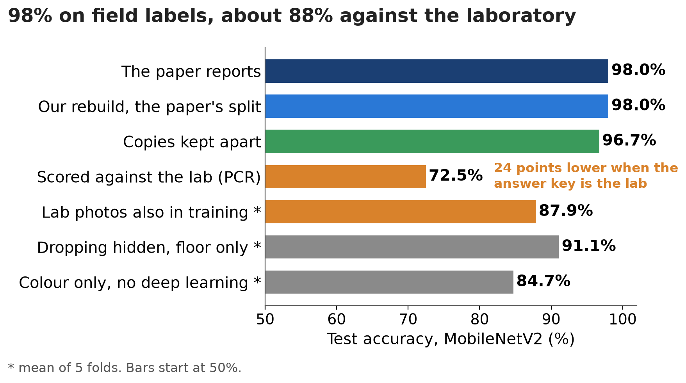

> [!IMPORTANT]
> The paper's 98% comes out again when I follow its method. But a colour count with no deep learning already reaches
> 85%, and a model that sees only the floor reaches 91%. Scored against laboratory (PCR) results, the honest
> figure is about 88%.

## The paper

Machuve D, Nwankwo E, Mduma N, Mbelwa J (2022). Poultry diseases diagnostics models using deep learning.
*Frontiers in Artificial Intelligence* 5: 733345. [10.3389/frai.2022.733345](https://doi.org/10.3389/frai.2022.733345)

It sorts droppings photos into four classes (Coccidiosis, Healthy, Newcastle disease, Salmonella) and recommends
MobileNetV2 for farmers' phones. Later papers on the same images report 97.8 to 99.1%.

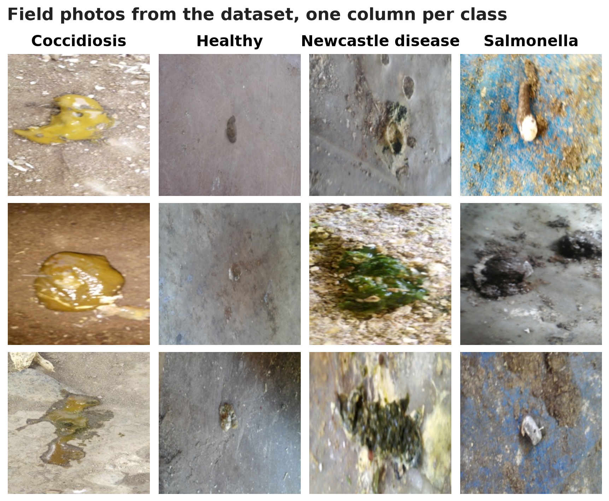

## How the work was built

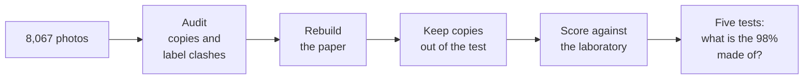

Each step is one Kaggle notebook, and each question was written down before its run.

| Question | Notebook | Answer |
| --- | --- | --- |
| Does the paper repeat? | 02 | Yes. MobileNetV2 98.02%, the same as the paper |
| Do copies of a photo inflate the score? | 01, 03 | A little: 0.5 to 2 points |
| Do field labels agree with the laboratory? | 03 | Only 7 times in 10 when no lab photos are used in training |
| Is the accuracy stable, and does the recipe matter? | 04 | Field photos vary by under 1 point across folds; the recipe hardly matters |
| What does the model actually use? | 05 | Mostly colour and the floor |

## What I found

### 1. The paper's numbers come out again

Same splits, same three training stages, same models. The settings the paper does not give are listed in the
notebooks.

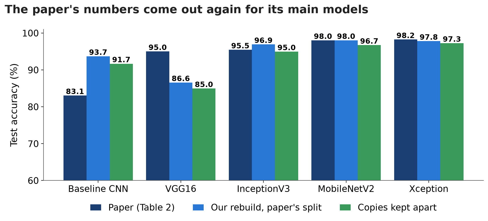

VGG16 is the exception. With the paper's recipe only its last two layers learn, and in my run it under-fits.

### 2. The data holds copies, and some carry two labels

| Finding | Count |
| --- | --- |
| Identical files | 222 groups, 280 extra copies |
| Identical files with two different labels | 3 pairs, all PCR photos |
| Re-saved files with two different labels | at least 3 more pairs |
| Near-copies (dHash distance of 4 bits or less) | 749 photos in 307 groups |
| Paper-style test photos with a copy in training | 67 certain, up to 109 of 1,363 |

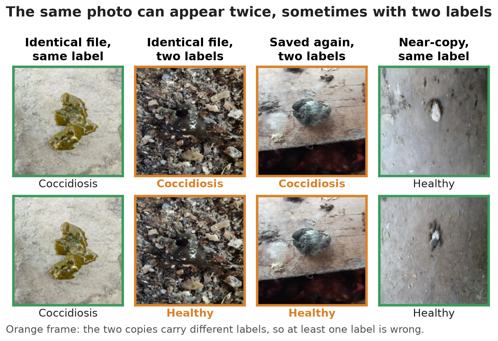

Keeping copies out of the test set costs 0.5 to 2 points, most of it in Newcastle disease, the smallest class.

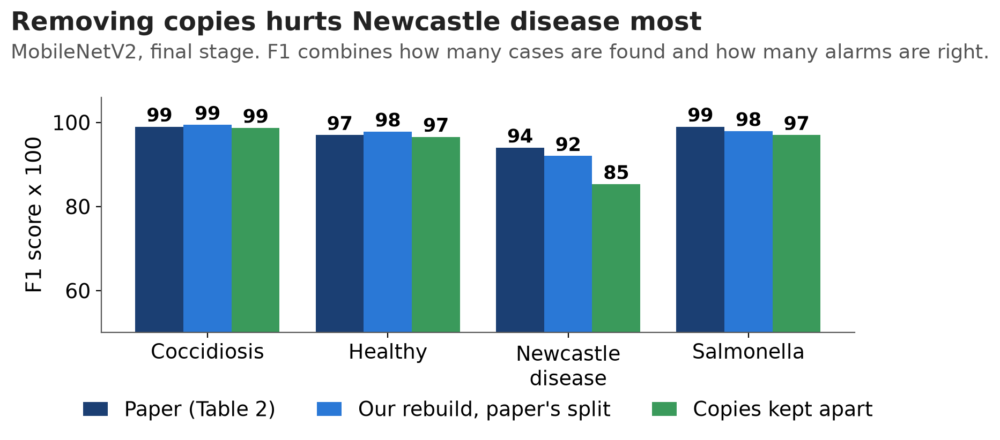

### 3. Field labels and laboratory labels disagree

A MobileNetV2 trained on field photos scores 96.7% against field labels, but 72.5% against PCR results. It finds only
40% of the PCR-confirmed Newcastle cases.

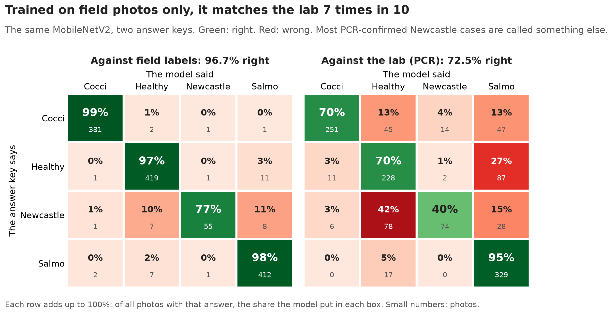

> [!NOTE]
> The authors' Zenodo record says the Salmonella and Newcastle field photos came from birds infected on purpose,
> and the healthy and Coccidiosis photos from farms. The paper says a vet labelled them by eye. Either way, the
> 6,812 field photos are not PCR-verified, although later papers describe them that way. See
> [DATA_CARD.md](DATA_CARD.md).

### 4. What the accuracy is made of (second run)

Five group-aware folds, so every clean photo is tested once by a model that never saw it or any copy of it.
Field photos and PCR photos are always scored apart.

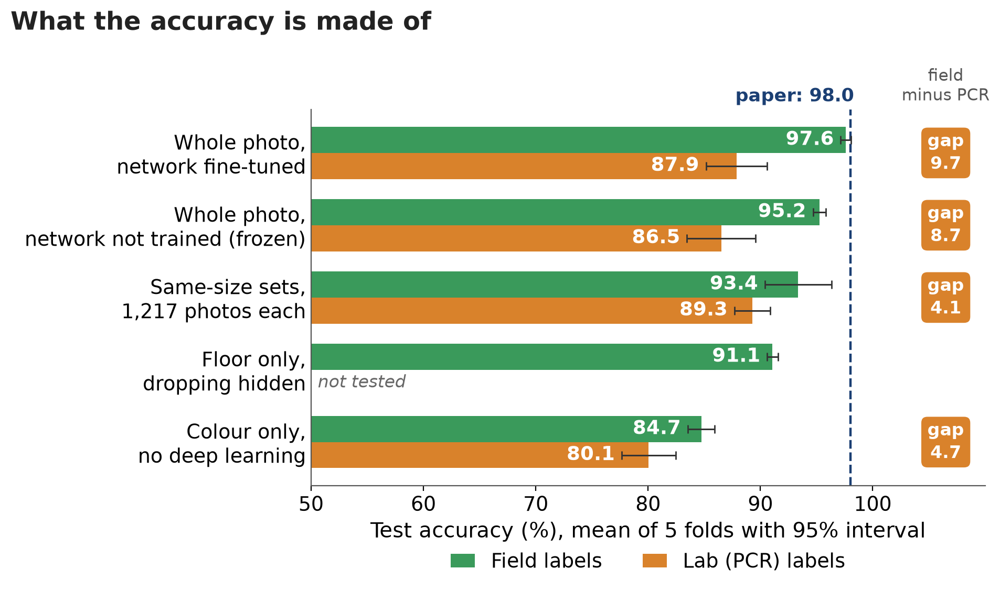

| Test | Field labels | PCR labels |
| --- | --- | --- |
| Whole photo, MobileNetV2 fine-tuned (both photo sets in training) | 97.6 (97.2 to 98.1) | 87.9 (85.2 to 90.6) |
| Whole photo, network not trained on these photos | 95.2 | 86.5 |
| Same-size sets, 1,217 photos each, own labels | 93.4 | 89.3 |
| Floor only, dropping painted grey | 91.1 | not tested |
| Colour histogram, no deep learning | 84.7 | 80.1 |

Accuracy in %, mean of 5 folds (95% interval in brackets). Balanced accuracy and per-class recall are in
[`results/`](results).

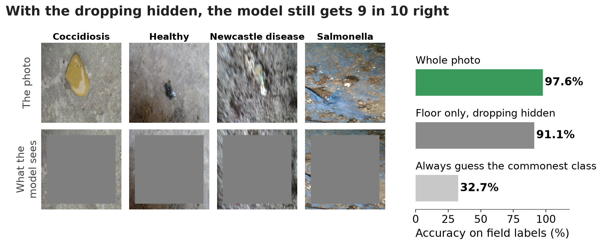

* **The floor gives the class away.** With the dropping hidden the model still gets 91% right, against 33% for always
  guessing the commonest class. That fits the photos being taken in different places for different classes.
* **The two photo sets look different.** A simple model tells field photos from PCR photos with an AUC of 0.97.
  So most of the drop to 72.5% was a change of photo, and with PCR photos in training the PCR score rises to 88%.
* **The gap does not close.** PCR photos score 7.5 to 12 points lower than field photos in every fold (corrected recipe).
* **PCR labels are learnable.** At the same size, PCR labels (89%) are about as learnable as field labels (92%,
  balanced accuracy), so they are a fair target.
* **The recipe hardly matters.** The paper's input settings against corrected ones: +1.5 points on field photos
  (p = 0.036), -1.7 on PCR photos (p = 0.12).

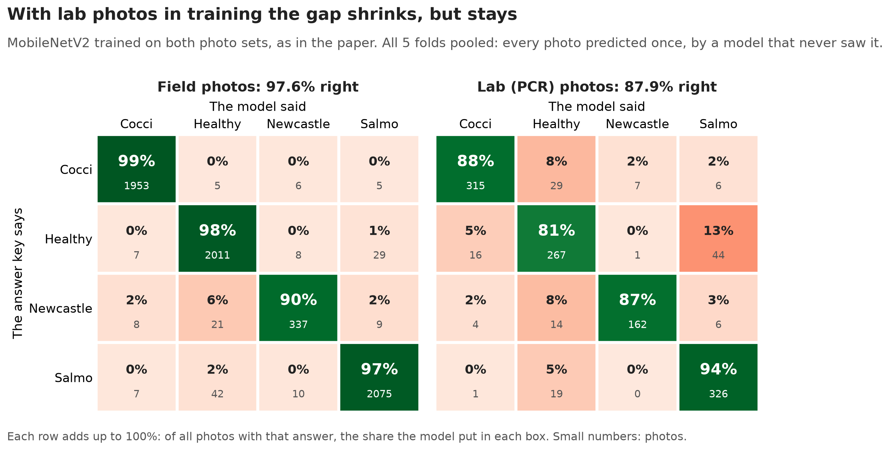

## Scorecard

Every test, disease by disease. Green is good, red is poor.

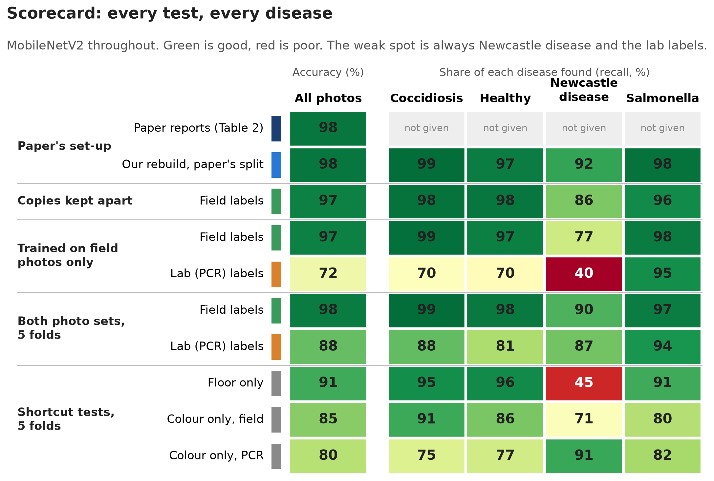

## What this means

1. The paper can be reproduced. The code was not the problem.
2. Most of the 98% is colour and setting. The field labels follow colour rules, and the classes partly follow where
   the photos were taken.
3. Against the laboratory the honest figure is about 88% (95% interval 85 to 91%).
4. Field photos are not PCR-verified, and claims built on them should say so.

## Later papers on the same data

| Paper | Model | Reported accuracy |
| --- | --- | --- |
| Degu et al. (2023), *Smart Agricultural Technology* | ResNet50 | 98.7 |
| Dhungana et al. (2025), *AgriEngineering* 7: 278 | EfficientNet-B0 | 99.12 |
| Neduncheziyan (2026) | DenseNet-121 | 97.75 |

All sit inside what field labels alone allow. None reports a group-aware split or a separate PCR score.

## Limitations

* The Kaggle images are 224 x 224 copies, not the original photos.
* dHash grouping also joins a few different photos on plain floors. That can only make the tests harder.
* In the floor-only test a few droppings reach the frame, so 91.1% is an upper limit.
* The second run uses MobileNetV2 only, so the GPU time could pay for 5 folds.
* I could not settle whether the paper or the Zenodo record describes the field labels completely.

## Reproduce

| Notebook | What it does | Kaggle |
| --- | --- | --- |
| 01 | Data audit: counts, copies, near-copies | [open](https://www.kaggle.com/code/mdraihanpatwary02/poultry-feces-01-data-audit) |
| 02 | The paper's experiment, all five models | [open](https://www.kaggle.com/code/mdraihanpatwary02/poultry-feces-02-paper-replication) |
| 03 | Copies kept apart, and field labels against PCR | [open](https://www.kaggle.com/code/mdraihanpatwary02/poultry-feces-03-leak-free) |
| 04 | H1: 5 folds, two recipes, field and PCR photos | [open](https://www.kaggle.com/code/mdraihanpatwary02/poultry-feces-04-stability-and-recipe) |
| 05 | H2 to H5: floor only, PCR learnability, photo source, simple features | [open](https://www.kaggle.com/code/mdraihanpatwary02/poultry-feces-05-shortcuts-and-labels) |

```bash
python build/build_01_audit.py        # write the notebooks into kernels/
python build/build_02_train.py
python build/build_second_run.py
kaggle kernels push -p kernels/04_stability_and_recipe
kaggle kernels output mdraihanpatwary02/poultry-feces-04-stability-and-recipe -p outputs/04
python scripts/make_figures.py        # redraw figures/ from results/ (add --images path/to/Train for the photos)
```

Run a smoke test first. Kaggle allows two GPU sessions at a time. On a T4, notebooks 02 and 03 take about 5 hours
each, 04 and 05 about 3 hours each.

<details>
<summary>About the code in this repository</summary>

The notebooks are written by the Python files in `build/`, so the code can be read and edited as plain `.py` files.
Comments and text cells were tidied after the Kaggle runs. `scripts/check_code_matches_kaggle.py` downloads each
notebook from Kaggle and compares every code cell by its syntax tree. All five match: the code here is the code
that produced the results.

```
build/      Python files that write the notebooks
kernels/    the notebooks and their Kaggle settings
results/    CSV and JSON outputs downloaded from Kaggle
figures/    figures drawn from results/
scripts/    make_figures.py, check_code_matches_kaggle.py
```

No images or trained models are stored here.
</details>

## Credit

Images and labels: Machuve D et al. (2021), Zenodo records
[4628934](https://doi.org/10.5281/zenodo.4628934) and [5801834](https://doi.org/10.5281/zenodo.5801834), CC BY 4.0.
The few example photos in `figures/` come from this dataset. All credit for the data goes to the authors and to the
farmers and laboratory staff in Arusha and Kilimanjaro. This work checks the analysis. It does not question the
value of the data, which is open, well documented and rare in this field.

Code: MIT licence. Cite with [CITATION.cff](CITATION.cff).
