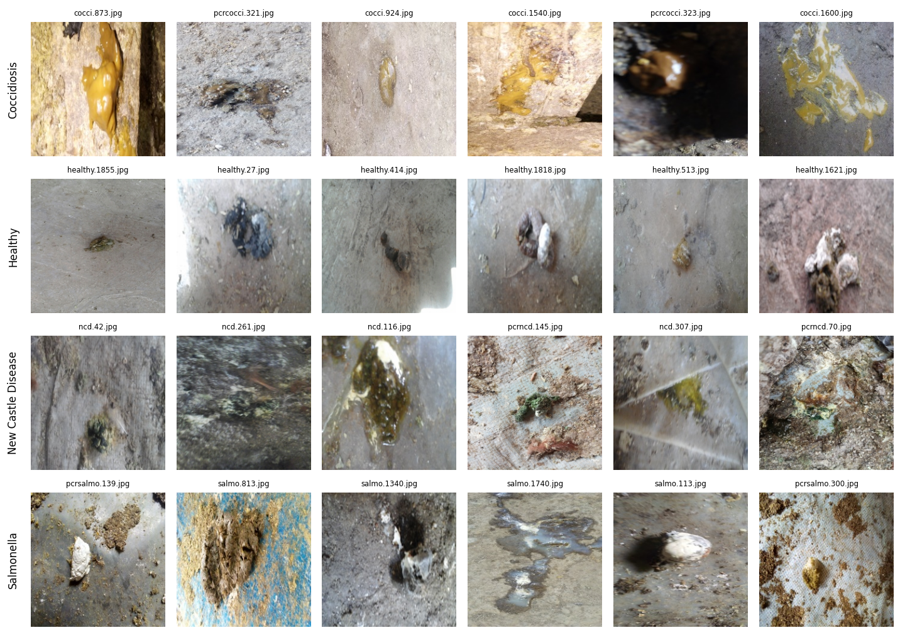
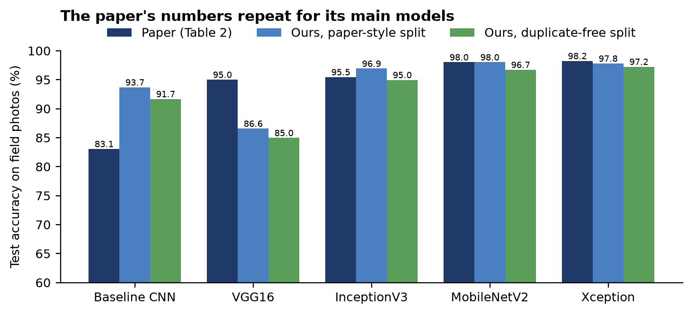
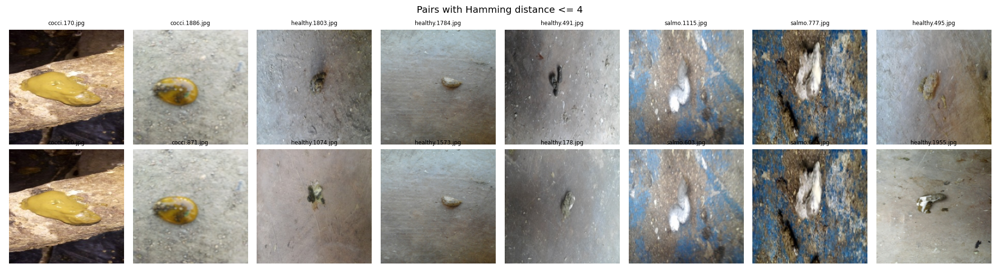
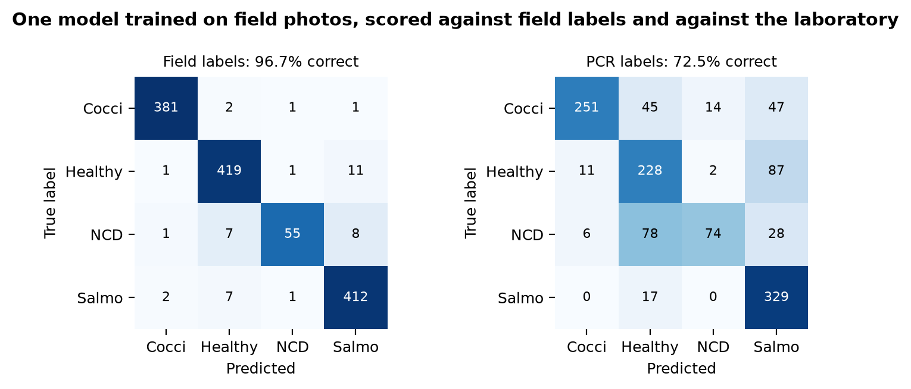
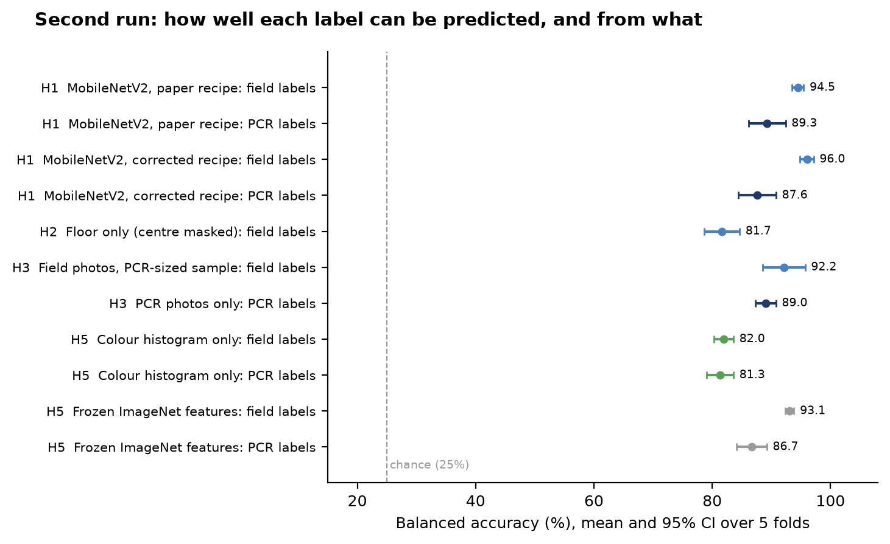
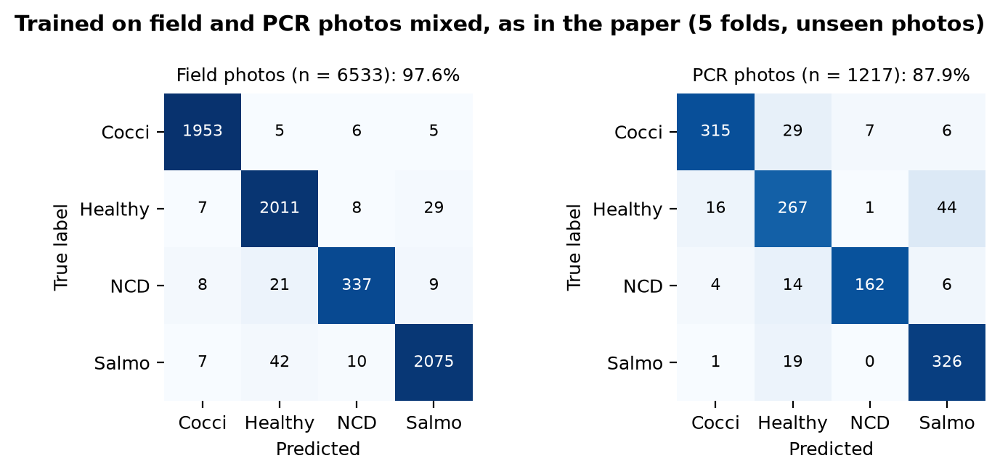
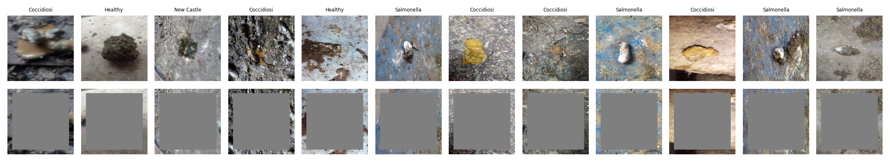

# DropCheck

Re-testing a published deep learning model that diagnoses poultry disease from photos of droppings.

The paper: Machuve D, Nwankwo E, Mduma N, Mbelwa J (2022). Poultry diseases diagnostics models using deep learning.
*Frontiers in Artificial Intelligence* 5: 733345. [10.3389/frai.2022.733345](https://doi.org/10.3389/frai.2022.733345)

It reports 98% accuracy for four classes: Coccidiosis, Healthy, Newcastle disease (NCD) and Salmonella.
This repository rebuilds that work from the paper's text and then asks what the 98% is made of.

## Why

High accuracy on one random split says little on its own. It can come from copies of the same photo on both sides
of the split. It can come from the place a photo was taken, not from the droppings. It can also come from labels that
were not checked by a laboratory. Later papers on the same images report 97.8 to 99.1% and cite the data as
lab-verified. So it is worth checking what the data and the numbers really support.

## What is different here

* **Audit first.** Every image is hashed before any model is trained. Copies and near-copies are found and grouped.
* **Splits by group.** A photo and its copies always stay on the same side of a split.
* **Two kinds of label.** The 6,812 field photos and the 1,255 PCR-tested photos are scored apart, never pooled.
* **Five folds, not one split.** Every number in the second run is a mean over 5 folds with a 95% confidence interval.
* **Shortcut tests.** Models are given only the floor, only colour, or only frozen features, to see how much of the
  accuracy is left without the dropping itself.
* **Everything rebuilds.** Notebooks are written from plain Python files in `build/` and run on Kaggle. Figures are
  rebuilt from the saved CSV files by `scripts/make_figures.py`.

## Data

Kaggle [`allandclive/chicken-disease-1`](https://www.kaggle.com/datasets/allandclive/chicken-disease-1), a 224 x 224
copy of the authors' Zenodo records [10.5281/zenodo.4628934](https://doi.org/10.5281/zenodo.4628934) (field set) and
[10.5281/zenodo.5801834](https://doi.org/10.5281/zenodo.5801834) (PCR set), both CC BY 4.0.
The counts match Table 1 of the paper exactly. See [DATA_CARD.md](DATA_CARD.md) for how the labels were made.



## First run: replicate, then remove the leak

### 1. The paper's numbers repeat

Same split sizes, same three training stages, same models. Test accuracy of the final stage, on field photos:

| Model | Paper (Table 2) | Ours, paper-style split | Ours, duplicate-free split |
| --- | --- | --- | --- |
| Baseline CNN | 83.06 | 93.69 | 91.68 |
| VGG16 | 95.01 | 86.57 | 84.96 |
| InceptionV3 | 95.45 | 96.92 | 94.96 |
| MobileNetV2 | 98.02 | 98.02 | 96.72 |
| Xception | 98.24 | 97.80 | 97.25 |

MobileNetV2 matches to two decimals. VGG16 is lower because the paper's recipe only trains its last two layers, and
our run under-fits with that setting.



### 2. The data has copies

| Finding | Number |
| --- | --- |
| Byte-identical copies | 222 groups, 280 extra files |
| Identical files with two different labels | 3 pairs (all in the PCR set) |
| Re-saved files with two different labels | at least 3 more pairs |
| Near-copies (dHash distance 4 bits or less) | 749 images in 307 groups |
| Paper-style test photos with a copy in training | 67 certain, up to 109 of 1,363 |



Removing the leak costs 0.5 to 2 points. The leak is real but it is not the main story.

### 3. Field labels and PCR labels disagree

A MobileNetV2 trained only on field photos scores 96.7% against field labels. On the PCR photos it scores
**72.5%**, and it finds only 40% of the PCR-confirmed Newcastle cases.



This drop has two possible causes: the labels disagree, or the PCR photos simply look different. The second run was
built to tell these apart.

## Second run: what is the accuracy made of?

All tests use the clean set (no conflicting groups, one copy per file) and the same 5 group-aware folds
(`StratifiedGroupKFold`, seed 42). Balanced accuracy is used where class sizes differ, because NCD is small.
Chance is 25%.



### H1. Training on both sets, as the paper did

MobileNetV2 was trained on field and PCR photos together and tested on unseen photos of each kind.

| Recipe | Test photos | Accuracy (95% CI) | Balanced accuracy (95% CI) | NCD recall |
| --- | --- | --- | --- | --- |
| Paper | field | 96.9 (96.2 to 97.7) | 94.5 (93.4 to 95.5) | 84.6 |
| Paper | PCR | 89.5 (86.7 to 92.3) | 89.3 (86.2 to 92.4) | 89.0 |
| Corrected | field | 97.6 (97.2 to 98.1) | 96.0 (94.8 to 97.2) | 89.7 |
| Corrected | PCR | 87.9 (85.2 to 90.6) | 87.6 (84.4 to 90.8) | 86.7 |

* With PCR photos in training, the PCR score rises from 72.5% to about 88%. So most of the first-run drop was a
  **change of image source**, not only label disagreement.
* A gap of about 8 to 9 points between field and PCR photos remains in every fold.
* The "corrected" recipe (inputs scaled to -1 to 1 as MobileNetV2 expects, both flips, milder brightness) helps on
  field photos (balanced accuracy +1.5 points, paired t-test p = 0.036, better in 5 of 5 folds) but not on PCR photos
  (-1.7 points, p = 0.12). The paper's recipe choices do not explain its results.
* Fold-to-fold spread of accuracy is 0.4 to 0.6 points on field photos and about 2.2 on PCR photos. A single split
  cannot separate models that differ by less than this.



### H2. The floor alone

The centre of each photo was painted grey and only a 16-pixel frame of floor was left.



With no dropping in view, MobileNetV2 still reaches **91.1% accuracy** (balanced 81.7%, 95% CI 78.7 to 84.6) on the
field labels. This is an upper bound, because a few droppings reach the edge of the frame. It still says that the
field classes can be told apart largely by where the photo was taken. The Zenodo record fits this: Salmonella and
NCD photos came from inoculated study birds, healthy and Coccidiosis photos from farms.

### H3. Are PCR labels learnable?

| Training and test set (same size, 1,217 photos) | Balanced accuracy (95% CI) |
| --- | --- |
| PCR photos, PCR labels | 89.0 (87.3 to 90.8) |
| Field photos, field labels, same class counts | 92.2 (88.6 to 95.7) |

The intervals overlap. The laboratory labels are about as learnable as the field labels at the same sample size,
so they are not noise.

### H4. Can a model tell field photos from PCR photos?

A logistic regression told the two sources apart with an AUC of **0.969** on frozen ImageNet features and 0.922
on colour alone. Within each disease class the AUC was 0.89 to 0.98. The two sets are two different kinds of photo.
Any model trained on one and used on the other is crossing a domain gap.

### H5. How far do simple features go?

| Features + logistic regression | Field labels: accuracy | PCR labels: accuracy |
| --- | --- | --- |
| Colour histogram only (HSV 8x4x4 + RGB mean and SD) | 84.7 | 80.1 |
| Frozen MobileNetV2 features, no fine-tuning | 95.2 | 86.5 |
| Fine-tuned MobileNetV2 (H1, corrected) | 97.6 | 87.9 |

A colour histogram alone beats the paper's own baseline CNN (83.1%). Frozen features with no deep training reach
95%. Fine-tuning adds about 2 points on field photos and about 1 point on PCR photos.

## What this means

1. The paper's numbers are reproducible. The code was not the problem.
2. The headline 98% is mostly reachable by colour and background. The field labels follow the colour rules used to
   make them, and the field classes partly follow where the photos were taken.
3. On laboratory-confirmed labels, the honest figure is about 88%, with a 95% interval of roughly 85 to 92%.
4. The field photos are not PCR-verified. Papers that call them so overstate what the data can show.

## Later papers on the same data

| Paper | Model | Reported accuracy |
| --- | --- | --- |
| Degu et al. (2023), *Smart Agricultural Technology* | ResNet50 | 98.7 |
| Dhungana et al. (2025), *AgriEngineering* 7: 278 | EfficientNet-B0 | 99.12 |
| Neduncheziyan (2026) | DenseNet-121 | 97.75 |

These sit inside the spread we see from field labels alone. None reports a group-aware split or a separate PCR score.

## Limitations

* Kaggle images are 224 x 224 copies, not the original photos.
* dHash grouping also joins some different photos on plain floors. This can only make tests harder.
* The floor-only test leaks a little dropping at the edge, so 91.1% is an upper bound.
* Only MobileNetV2 was used in the second run, to keep the GPU budget for 5 folds.
* We could not settle which description of the field labels (paper or Zenodo) is complete.

## Reproduce

Needs a Kaggle account with the CLI set up. Each notebook explains every step in its own text cells.

```bash
python build/build_01_audit.py        # writes kernels/01_data_audit
python build/build_02_train.py        # writes kernels/02, 03 and the smoke test
python build/build_second_run.py      # writes kernels/04, 05 and their smoke tests
kaggle kernels push -p kernels/04_stability_and_recipe
kaggle kernels output mdraihanpatwary02/poultry-feces-04-stability-and-recipe -p outputs/04
python scripts/make_figures.py        # rebuilds figures/ from results/
```

Run a smoke test first. Kaggle allows two GPU sessions at a time. GPU time on a T4: about 10 hours for notebooks
02 and 03 together, about 3 hours each for 04 and 05.

| Notebook | What it does | Kaggle |
| --- | --- | --- |
| 01 | Data audit: counts, copies, near-copies | [link](https://www.kaggle.com/code/mdraihanpatwary02/poultry-feces-01-data-audit) |
| 02 | Paper replication, all five models | [link](https://www.kaggle.com/code/mdraihanpatwary02/poultry-feces-02-paper-replication) |
| 03 | Duplicate-free split, field to PCR test | [link](https://www.kaggle.com/code/mdraihanpatwary02/poultry-feces-03-leak-free) |
| 04 | H1: 5 folds, two recipes, field and PCR tests | [link](https://www.kaggle.com/code/mdraihanpatwary02/poultry-feces-04-stability-and-recipe) |
| 05 | H2 to H5: floor only, PCR learnability, source test, simple features | [link](https://www.kaggle.com/code/mdraihanpatwary02/poultry-feces-05-shortcuts-and-labels) |

## Repository

```
build/      Python files that write the notebooks
kernels/    the notebooks and their Kaggle settings
results/    CSV and JSON outputs downloaded from Kaggle
figures/    figures rebuilt from results/
scripts/    make_figures.py
```

No images or trained models are stored here.

## Credit

Images and labels: Machuve D et al. (2021), Zenodo records 4628934 and 5801834, CC BY 4.0. All credit for the
data goes to the authors and to the farmers and laboratory staff in Arusha and Kilimanjaro. This work checks the
analysis. It does not question the value of the data, which is open, well documented and rare for this field.

Code: MIT licence. Cite with [CITATION.cff](CITATION.cff).
